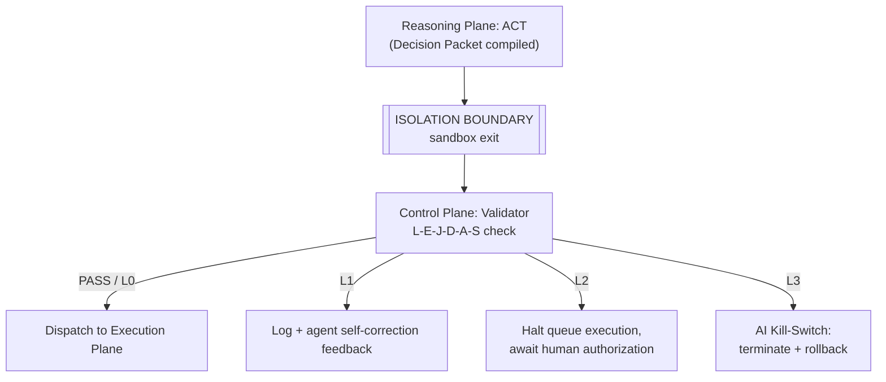
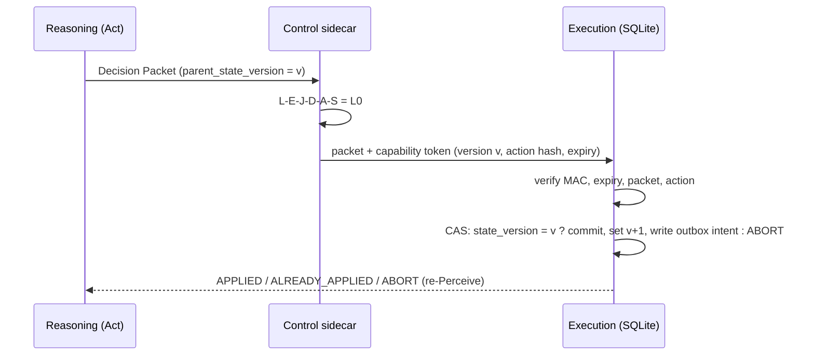

# Control Plane

The Control Plane is META-CORE's safety gateway. It runs **out-of-process**,
in an isolated sidecar container, specifically so that a compromised
Reasoning Plane cannot reach into it and disable its own guardrails. It has
two modules: the **Validator** (evaluates *what* the agent wants to do) and
the **AI Kill-Switch** (monitors *how* the agent is behaving).

## Why a sidecar, not in-process

| | In-process validation | Out-of-process sidecar (chosen) |
|---|---|---|
| Latency | Sub-millisecond | Minor IPC/serialization overhead |
| Security | A jailbroken model can potentially patch validator memory to force "pass" | Compromise of the reasoning sandbox has no path to the validator's memory space |
| Verdict | Rejected — see [ADR-0003](../decisions/0003-sidecar-isolated-safety-modules.md) | Adopted |

## Validator (`validator.py`)

Evaluates every Decision Packet against the six-field **L-E-J-D-A-S**
safety framework and assigns an **L0–L3 escalation level**. Full detail:
[`docs/security/l-e-j-d-a-s-framework.md`](../security/l-e-j-d-a-s-framework.md).

## AI Kill-Switch

Monitors runtime telemetry and forces an emergency stop when a bound is
breached:

| Signal | What it protects against |
|---|---|
| Execution time | Runaway / hung reasoning cycles |
| Memory footprint | Host resource exhaustion |
| Token consumption | Uncontrolled LLM billing |
| Cyclic / recursive loops | Infinite logical loops, redundant tool calls |

The Kill-Switch executes independently of the Reasoning Plane's health — it
can terminate the sandbox process even if the Python interpreter is
100% CPU-saturated or otherwise unresponsive.

The loop and spend signals are **admission control**: they run *before* a tool
call is dispatched, in `LoopCircuitBreaker`
([`src/control/validator.py`](../../src/control/validator.py)):

| Check | What it catches |
|---|---|
| Exact repeat on `SHA-256(JCS({tool_name, args}))` at an unchanged `state_version` | Identical calls; key order and `1` vs `1.0` no longer evade it |
| Structural cycle (tool-name pattern of period 2–4, repeated, no state change) | `A → B → A → B` with changing arguments |
| Consecutive-error breaker (N = 3 per tool) | A failing tool retried in a loop |
| Pre-flight token bucket (`input_tokens + max_output_tokens` reserved atomically before dispatch) | Runaway spend, including parallel bursts |
| Step limit and per-`state_version` cap | Anything else that keeps going; bounds read-only exploration |

Legitimate read-only exploration (pagination, lookups by different keys) is not a
cycle when every call in the window is a tool the **trusted side** declared read-only
(`read_only_tools`; the agent cannot flag its own calls) and no `(tool, args)` hash
repeats inside the window; mutating tools or repeated arguments still halt.

Rules, defaults and limits (including false positives): [ADR-0011](../decisions/0011-loop-detection-algorithm.md).
The gateway enforces the same ceilings on the wire:
[ADR-0012](../decisions/0012-ai-gateway-egress-implementation.md).

## Validation gate in the PTAC flow

## From approval to execution: closing TOCTOU

A passed L-E-J-D-A-S check is bound to the state it was computed against. On L0
the sidecar issues a short-lived **capability token**
`HMAC-SHA256(secret, packet_id ‖ expected_state_version ‖ action_hash ‖ expires_at_ms)`;
the Execution Plane verifies it and applies the mutation only through a
compare-and-swap on `state_version`. A stale version means ABORT and return to
Perceive. Token format, commit algorithm, cross-language test vector and residual
risk (external side effects are not covered): [ADR-0016](../decisions/0016-capability-tokens-and-cas.md).

## Security properties

- **Capability binding** — an approval cannot be replayed, redirected to another
  action, or applied on top of a newer state.
- **Prompt-injection containment** — safety rules cannot be reflected on or
  memory-patched from inside the reasoning sandbox.
- **Malformed payload defense** — non-conforming Decision Packets are
  dropped at the boundary, never reaching the database.
- **Escalation isolation** — L0–L3 tiers let the system respond
  proportionally instead of hard-crashing on every minor violation.
- **Fail-secure default** — if the sidecar loses its link to the Execution
  Plane, dispatches are blocked by default (architectural extrapolation —
  not yet confirmed in source material).

## Open questions

- The concrete evaluation logic and numeric thresholds distinguishing L0,
  L1, L2, and L3.
- The transport protocol (HTTP, Unix socket, gRPC) carrying Decision Packets
  from `agent.py` to the sidecar.
- The signal used to terminate the sandboxed agent process (`SIGKILL`,
  `SIGTERM`, or a webhook-style stop request).
- Rollback/state-recovery behavior for transactions cut off mid-flight by an
  L3 kill.
- Kill-Switch ceilings for execution time and memory are unset; the loop,
  error and token-bucket defaults in
  [ADR-0011](../decisions/0011-loop-detection-algorithm.md) are uncalibrated
  starting values.
- Capability-key provisioning and rotation; Redis CAS path and outbox (specified, not
  implemented); the actuator-side state check and the dispatcher's tool registry
  ([ADR-0016](../decisions/0016-capability-tokens-and-cas.md)).

Reference implementation and tests: `src/control/validator.py`,
`tests/test_control_invariants.py`.

See [`docs/open-questions.md`](../open-questions.md) for the full list.
