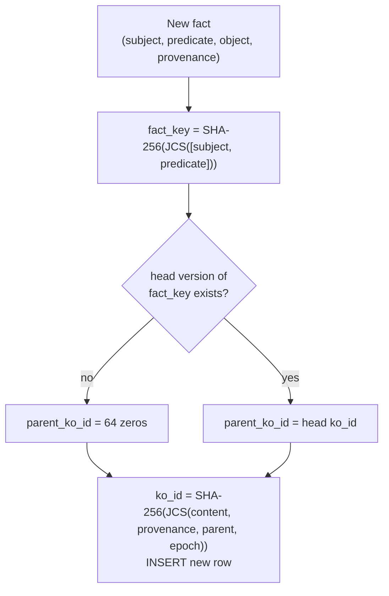
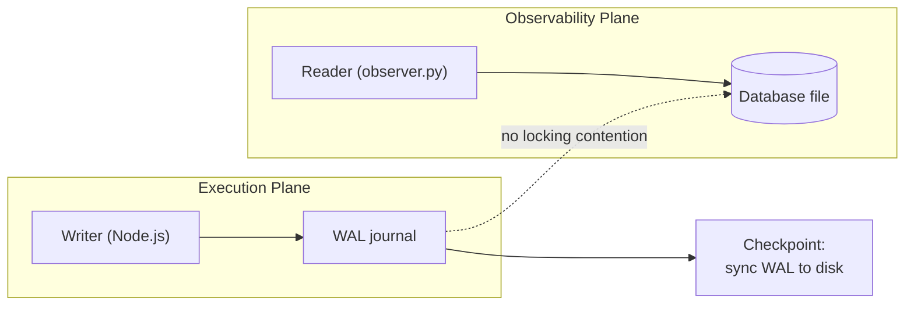

# Data Architecture

META-CORE segregates data across three storage mechanisms, each matched to
the plane that owns it:

| Store | Owning plane | Mechanism | Structure |
|---|---|---|---|
| EGDS Knowledge DB | Execution (write) / Reasoning (trusted views only) | SQLite tables, append-only | `KO = (ko_id, fact_key, parent_ko_id, subject, predicate, object, embedding, provenance, created_epoch)` |
| Transaction DB | Execution | SQLite, Write-Ahead Logging (WAL) | Transactional metadata, queue state |
| Event ledger | Observability | Append-only local file (`event_stream.jsonl`) | Line-delimited JSON step events |

## Knowledge Objects: versioned, content-addressed, provenance-bound

Every fact is stored as one immutable **version** row:

```
KO = (ko_id, fact_key, parent_ko_id, subject, predicate, object, embedding, provenance, created_epoch)

fact_key = SHA-256(JCS([subject, predicate]))                 logical identity of the fact
ko_id    = SHA-256(JCS({content: {subject, predicate, object},
                        provenance, parent_ko_id, created_epoch}))   identity of this version
```

JCS is RFC 8785 canonical JSON; it makes the encoding injective (no field can be
shifted across a boundary) and language-independent.



- **Why two ids.** `fact_key` is what the earlier text called `id`: it collapses
  re-assertions of one subject/predicate into one logical fact, and `object` is
  not part of it, so a changed value is another *version of the same fact*.
  `ko_id` identifies the version and covers the value, provenance, parent and
  time.
- **Append-only.** A new value is a new row whose parent is the previous version.
  Rows are never updated or deleted (triggers abort), and `UNIQUE(fact_key,
  parent_ko_id)` forbids forks.
- **Provenance is part of the id** (`ORGANIC_USER`, `SYNTHETIC_AGENT`,
  `VERIFIED_EXTERNAL`). It is assigned by the trusted side from the ingress
  channel; an agent-channel packet declaring anything but `SYNTHETIC_AGENT` is
  rejected.
- **Trusted read path.** RAG, analytics and adaptation read only
  `v_trusted_knowledge` / `v_trusted_knowledge_current` through a read-only
  connection whose authorizer denies the raw table.

Verification: the `ko_verify_integrity` trigger recomputes `fact_key` and `ko_id` inside
the database at INSERT time (registered SQL function `sha256_hex`, canonical object
text required), so a forged or stale id is refused; `audit_ko_ids` is the second line.
This proves an id is a correct derivation, not that the writer was entitled to write
it. DDL cannot forbid reads, so the reader restriction is per connection and the real
boundary is [ADR-0002](../decisions/0002-execution-plane-exclusive-db-access.md).
Full rationale and alternatives: [ADR-0013](../decisions/0013-provenance-typed-knowledge-objects.md).
Schema: [`src/data/schema.sql`](../../src/data/schema.sql); helpers:
[`src/data/store.py`](../../src/data/store.py).

## SQLite WAL mode

Standard SQLite journaling blocks readers during a write. META-CORE enables
**Write-Ahead Logging** specifically so the Observability Plane can run
read-only queries concurrently with the Execution Plane's writes, with zero
lock contention — see [ADR-0004](../decisions/0004-sqlite-wal-mode.md).



## Dual schema validation

Two validation frameworks guard the boundary between the Reasoning Plane's
free-form LLM output and the Execution Plane's typed database writes:

| Framework | Plane | Validates |
|---|---|---|
| JSON Schema 2020-12 | Reasoning / Control | Structure of the model's raw output → Decision Packet |
| Zod (TypeScript) | Execution | Type-safety of arguments immediately before a DB write |

Both are needed because they run in different languages on different sides
of the IPC boundary; keeping them in sync is an explicit open risk — see
[ADR-0006](../decisions/0006-dual-schema-validation.md).

## Vector search in the MVP

For the MVP, embeddings are stored as raw values inside the same SQLite
database rather than a dedicated vector index, trading maximum query
performance for deployment simplicity. See
[ADR-0010](../decisions/0010-sqlite-for-vector-storage-mvp.md) for the
trigger conditions to revisit this.

## Open questions

- The underlying engine for the EGDS Knowledge DB (plain relational tables,
  `pgvector`, or an embedded key-value store).
- The embedding pipeline — local model vs. external API — used to populate
  the `embedding` field.
- Case, whitespace and Unicode-normalization policy for `subject`/`predicate`
  before hashing (JCS fixes the encoding, not the normalization).
- Fallback behavior on a SHA-256 collision.
- Whether the writer skips an insert when the new content equals the head version
  (today an identical re-assertion creates a new version).
- Where re-embedding lives, given that rows are immutable.
- The ledger also needs a `state_ledger` scope per consistency domain; how scopes
  map to tables is not decided.

See [`docs/open-questions.md`](../open-questions.md) for the full list.
